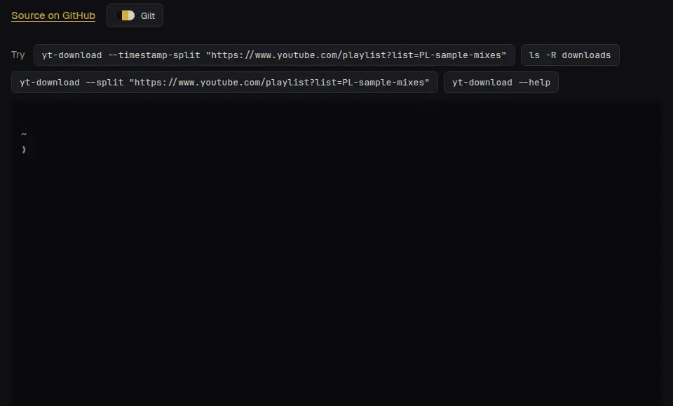

# YouTube Playlist Downloader

Download YouTube videos or playlists as MP3 files, optionally splitting recordings into named tracks.



**[Try it in your browser](https://yt-download.soleone.xyz)**, no install. A sample playlist stands in for YouTube.

A Node.js/TypeScript CLI orchestrates `yt-dlp` and `ffmpeg`. No YouTube API key is needed.

## Setup

Requires:

- Node.js **22+** and npm
- A current `yt-dlp` installation with its EJS challenge solver
- `ffmpeg`, plus `ffprobe` for splitting (usually installed together)

### Ubuntu 26.04: apt backports

With `resolute-backports` enabled, install or update the current backported version:

```bash
sudo apt-get update
sudo apt-get install -t resolute-backports yt-dlp
/usr/bin/yt-dlp --version
```

A plain `sudo apt install yt-dlp` can keep an older version from the main release repository: backports have lower priority unless explicitly selected. The available `2026.08.19` backport includes the EJS solver and has been checked against a small audio sample from YouTube.

Use the backports repository matching your Ubuntu release; `resolute-backports` is specific to Ubuntu 26.04. Other distributions may offer different versions or backports instructions.

**Switching from a uv installation:** the CLI prefers `~/.local/bin/yt-dlp` over `/usr/bin/yt-dlp`. After successfully upgrading and verifying the apt copy, remove the uv-managed copy to let the CLI use apt:

```bash
uv tool uninstall yt-dlp
```

### User-local alternative: uv or pipx

If your distribution does not offer a recent enough version, install a current user-local `yt-dlp`, including the EJS solver, with [uv](https://docs.astral.sh/uv/):

```bash
uv tool install --upgrade "yt-dlp[default]"
```

This command also updates an existing uv installation. Alternatively, use pipx:

```bash
pipx install "yt-dlp[default]"
# To update an existing pipx installation:
pipx upgrade yt-dlp
```

Or use `python3 -m pip install --user -U "yt-dlp[default]"` if your Python environment permits user installs. The CLI prefers `~/.local/bin` over system copies. Distribution packages such as apt can lag behind YouTube changes.

Install `ffmpeg` with your system package manager:

```bash
# macOS
brew install ffmpeg

# Ubuntu/Debian
sudo apt update && sudo apt install -y ffmpeg
```

Then, from this repository:

```bash
npm install
```

This installs the development dependencies and builds the CLI. There are no npm runtime dependencies. After editing TypeScript, rebuild with `npm run build`.

Install external tools separately. The CLI uses Node as yt-dlp's JavaScript runtime. See [yt-dlp's EJS setup guide](https://github.com/yt-dlp/yt-dlp/wiki/EJS) for other installation methods.

## Quick start

```bash
./bin/yt-download "YOUTUBE_PLAYLIST_OR_VIDEO_URL"
./bin/yt-download "URL" ~/Music/youtube
```

To install the `yt-download` command from this checkout:

```bash
npm link
yt-download "URL"
yt-download --timestamp-split "URL"
```

`bin/yt-download` is the executable Node entry point, registered in `package.json`'s `bin` field. You can also run it with `npm start -- "URL"`.

Downloads go to `./downloads` relative to your working directory by default. Existing MP3s are skipped unless `--force` is supplied. With no URL, an interactive terminal prompts for one.

## Timestamp splitting

```bash
./bin/yt-download --timestamp-split "URL"
./bin/yt-download --timestamp-split "URL" ~/Music/youtube
```

For each video, including videos inside playlists:

1. Use chapter metadata supplied by `yt-dlp`.
2. If there is no usable chapter list, parse the video description for timestamps and track names.
3. Split from each timestamp to the next, and from the last timestamp to the recording's end.

Supported description formats include:

```text
00:00 - Opening Theme
03:12 Second Track
[07:45] Third Track
Fourth Track 1:02:03
```

Track names come from the labels alongside timestamps and are numbered sequentially:

```text
downloads/Album/
├── 01 - Album.mp3
└── 01 - Album - tracks/
    ├── 01 - Opening Theme.mp3
    ├── 02 - Second Track.mp3
    ├── 03 - Third Track.mp3
    └── 04 - Fourth Track.mp3
```

If a timestamp has no label, its timestamp becomes the name, for example `02 - 03-12.mp3`. Colons and other unsafe filename characters are replaced with hyphens. Track title, track number, and album title are also written as MP3 metadata.

- At least two valid timestamps/chapters are required, in strictly increasing order and within the recording's duration. Invalid lists are not guessed or reordered.
- If the first timestamp is after zero, an `Intro` track preserves the preceding audio. Short tracks are not discarded.
- If no usable timestamps are found, keep the full recording and report that it could not be split. **There is no silence fallback with `--timestamp-split`.**
- The original MP3 is always retained. Each downloaded source filename gets its own track folder rather than writing all playlist tracks into one shared directory.
- Existing track folders are skipped unless `--force` is provided. Splitting can run against an already-downloaded MP3; timestamps are refreshed through `yt-dlp`.
- All cuts finish in a temporary staging folder before being published. Failed cuts leave the original and existing tracks intact.
- `--force` replaces generated files with matching names, not unrelated files in the track folder. If track names change, older differently named tracks are left in place.
- Splitting stream-copies the audio without re-encoding. Boundaries are limited to MP3 frame precision. Embedded artwork and other source tags are not copied to the split tracks; they remain in the full MP3.

## Other options

```bash
./bin/yt-download --force "URL"
./bin/yt-download --force --timestamp-split "URL"
./bin/yt-download --split "URL"
./bin/yt-download --help
```

`--split` enables automatic splitting: timestamps first, then silence detection for recordings at least 15 minutes long. Silence detection uses `-35dB` and a 1.2-second minimum silence, keeping tracks at least 45 seconds long without discarding short fragments. Do not combine `--split` and `--timestamp-split`.

The CLI deliberately ignores external `yt-dlp` configuration so output paths, overwrite behavior, and postprocessing remain predictable. It uses yt-dlp's current default YouTube clients rather than pinning clients in the wrapper.

## Troubleshooting YouTube HTTP 403

A `403: Forbidden` while downloading video data happens before timestamp splitting: YouTube rejected the media request. It can be intermittent, or caused by an outdated extractor.

First update `yt-dlp` using the installer that manages it. For Ubuntu 26.04 with backports enabled:

```bash
sudo apt-get update
sudo apt-get install -t resolute-backports yt-dlp
/usr/bin/yt-dlp --version
```

For uv, include the `default` extras for the EJS solver:

```bash
uv tool install --upgrade "yt-dlp[default]"
~/.local/bin/yt-dlp --version
```

Then retry the same `yt-download` command. If both copies are installed, the CLI still prefers the user-local copy; see the switching instructions above. A user-local installation leaves apt's package untouched. Do not hide the outdated-version warning with `--no-update`; that does not fix extraction. If a current version still returns 403, network/IP restrictions or other YouTube changes may need separate investigation.

## Development

```bash
npm run check
npm test
npm pack --dry-run
```

Packaging rebuilds the CLI and includes `bin/`, compiled `dist/src/`, and the README, excluding tests and downloads. The package remains private until it is ready to publish.

Tests cover timestamp parsing, filename safety, track tags, overwrite behavior, playlist isolation, and failure cleanup. Audio integration tests use local fixtures and skip if `ffmpeg`/`ffprobe` are unavailable. A real `yt-dlp` metadata smoke test also runs when it is installed, against a local HTTP server rather than YouTube.
